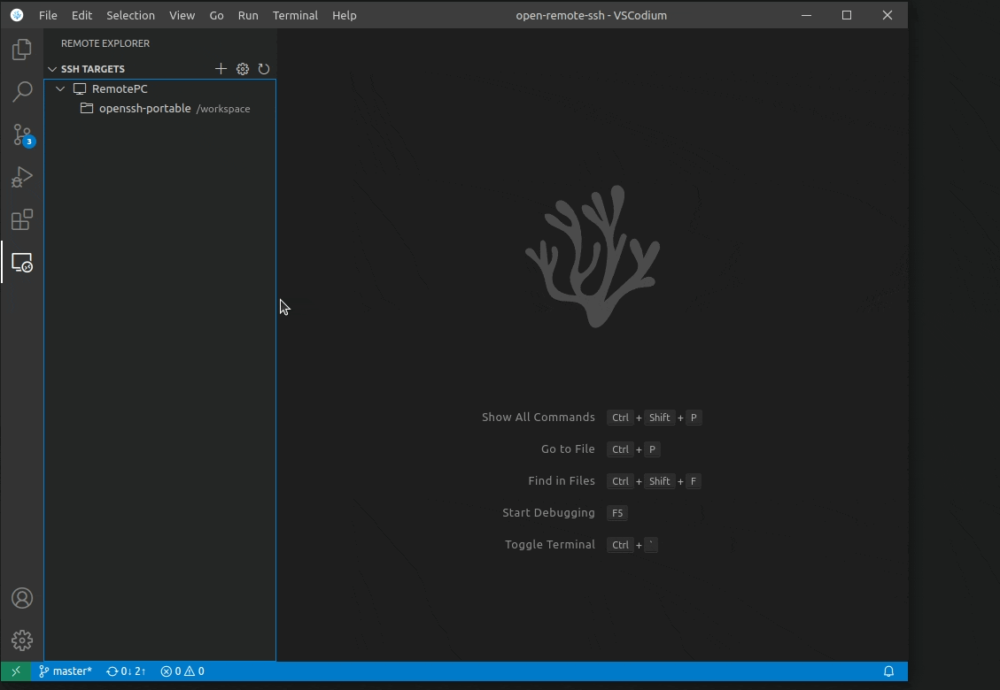

# Open Remote - SSH (tmux)

A VS Code / VSCodium extension that connects to a remote dev machine over
SSH — **identical to [open-remote-ssh](https://github.com/jeanp413/open-remote-ssh)
in look and feel** — with one under-the-hood upgrade: **remote terminals are
backed by [tmux](https://github.com/tmux/tmux)**, so they persist and can be
re-attached from any machine.



## Why

You work across a PC, a laptop, and a VPS that's the actual dev environment.
Close the PC, open the laptop, and land back in the **same terminals** — same
scrollback, same running processes (a long `Claude Code` task, a build, a
migration) — regardless of which client connected last or whether the network
dropped in between.

With stock open-remote-ssh, a remote terminal's lifetime is coupled to the
client/session that opened it: closing the window, switching machines, or a
vscode-server restart can take a running task down with it. This fork moves
that lifetime into a **tmux server on the remote** — a process no client
owns — so terminals and the work inside them outlive any one connection.

**Scope is terminals only.** Editing, file changes, saving, extensions, and
port forwarding already reconnect fine (the vscode-server persists) — this
fork doesn't touch that path. It's invisible: no tmux commands, no tmux UI,
same connect flow as open-remote-ssh. See
[`docs/idea/why.md`](docs/idea/why.md) for the full motivation and
[`docs/idea/persistence-model.md`](docs/idea/persistence-model.md) for the
honest technical picture (below).

## Install

Releases ship as a `.vsix` on the
[Releases page](https://github.com/developerz-ai/open-remote-ssh-tmux/releases)
(not yet on Open VSX or the VS Code Marketplace).

1. Download `open-remote-ssh-tmux-<version>.vsix` from the latest release.
2. Optionally verify it against the published `.sha256`:
   `sha256sum -c open-remote-ssh-tmux-<version>.vsix.sha256`
3. In VS Code / VSCodium: Command Palette → `Extensions: Install from VSIX…`
   → pick the downloaded file.
4. VSCodium < 1.75 and VSCode-OSS also need the extension enabled in
   `argv.json` — see [Activation](#activation) below.
5. **Fully close and reopen the remote window.** This extension resolves the
   remote authority, so a newly installed build only takes effect on a fresh
   resolve — `Developer: Reload Window` alone is not always enough.

### Installing a locally built VSIX

```bash
npm run package          # produces open-remote-ssh-tmux-<version>.vsix
```

> **Bump the version before reinstalling.** Installing a `.vsix` whose version
> matches the already-installed one is frequently a silent no-op — you keep
> running the old code while believing you upgraded. Either bump `version` in
> `package.json`, or uninstall the extension first.

### Verifying it actually wired up

The extension is a **UI extension** (`extensionKind: ["ui"]`): it runs on your
*local* machine, not the remote. Do not expect to find it in the remote's
extension list. To confirm the tmux layer engaged, open
`Remote-SSH: Show Log` and look for:

```
Tmux terminal layer wired successfully
tmux terminals: 1 re-attached, 0 reclaimed, 0 adopted, 0 pruned
```

If instead you see `Tmux wiring failed: …`, the layer is off and terminals fall
back to plain shells — see [Troubleshooting](#troubleshooting).

## Contributing: local checks

On Linux or macOS, use Node **20.20.2** (`.nvmrc`) and npm, plus a
supported Python 3 and **pipx** for workflow linting. These are local developer
prerequisites, not requirements for using the extension. npm does **not**
install Python or pipx. Install pipx with your OS package manager (for example,
`brew install pipx` on macOS, or `sudo apt install pipx python3-venv` on
Debian/Ubuntu), then:

```sh
pipx ensurepath
# Open a new shell so the PATH update takes effect, then:
python3 --version
pipx --version
npm install
pipx run zizmor --version
npm run ci:lint
```

See [pipx installation](https://pipx.pypa.io/stable/installation/) for other
Unix distributions. Ensure `pipx` is on the PATH inherited by your editor's
Git hooks, not just an interactive shell. `pipx run zizmor` acquires zizmor in
an isolated cached environment; no global `zizmor` executable is needed.
First use (and cache refresh) requires network access to the Python package
index and writable pipx/cache directories. An offline empty cache cannot run
this check; acquisition errors fail the hook rather than skipping it.

### What the hook checks

[`.lintstagedrc.yml`](.lintstagedrc.yml) runs fixpack on a staged `package.json`,
ESLint on staged `*.ts`, and `pipx run zizmor` on staged workflow YAML, with
lint-staged appending the matched paths. `npm run ci:lint` checks
all workflows via `pipx run zizmor .`; `npm run ci:lint:fix` uses the same
command with `--fix=all` (and can modify workflows).
[The pre-commit hook](.husky/pre-commit) runs lint-staged, then compilation and
tests. Husky invokes it with `sh -e`: a failed staged check stops the hook.

**The TypeScript glob is not root-only.** Installed lint-staged **16.4.0**
enables `matchBase: !pattern.includes('/')` in
[`lib/matchFiles.js:10–21`](https://github.com/lint-staged/lint-staged/blob/v16.4.0/lib/matchFiles.js#L10-L21).
[`lib/generateTasks.js:22–40`](https://github.com/lint-staged/lint-staged/blob/v16.4.0/lib/generateTasks.js#L22-L40)
matches relative paths and returns absolute task paths by default. Keep
`"*.ts": eslint`: it already includes nested TypeScript files.

### Reproduce the evidence

```sh
npm test -- test/lint-staged.test.ts --maxWorkers=2
```

Observed by editor[bot] in the focused run (`npm test -- test/lint-staged.test.ts
--maxWorkers=2`, Vitest **4.1.10**, Node **v24.21.0**): **8 passed, 1 skipped,
0 failed (9 total)**, command exit **0** — on this box, which has no `pipx`.
Real ESLint **10.5.0**, invoked through installed lint-staged's task runner on
temporary nested TypeScript files, returned **0** for valid code and **1** for
`@typescript-eslint/no-explicit-any`; the task runner propagated that failure.
This is file-based execution, not stdin-only evidence. Matcher tests loaded the
actual YAML and installed lint-staged internals through native ESM: root and
nested TS reach ESLint, unrelated files do not, and workflow paths are retained.
The matcher anchors above disprove the root-only premise; no glob correction was
needed. On a box where `pipx` and `python3` are on PATH and PyPI is reachable,
the same command runs all nine tests — the gated acquisition test executes for
real instead of skipping.

**Stub evidence, not real zizmor:** the regression test executes lint-staged's
actual task runner with a temporary pipx stub, checks its exact appended
arguments, and observes success/failure for stub exits **0/17**. Temporary
npx/npm stubs run the real pre-commit script under `sh -e`: exits **0/23**
propagate, and failure prevents compilation/tests from being invoked. No Git
operations or real compilation are performed by these stub tests.

**Real zizmor integration is gated, not blocked:** where `pipx` and `python3`
are on the parent PATH and `https://pypi.org/simple/` answers within its short
timeout, the integration test acquires real zizmor through `pipx run` with a
cold cache and requires an actual `template-injection` finding naming the unsafe
workflow plus a propagated nonzero exit — there, a failed acquisition fails the
test. Where a prerequisite is missing, Vitest reports the test as **skipped**
with the reason logged (this run: `Skipped real zizmor acquisition —
environment lacks: pipx on PATH`), so it is visible in the summary and never
counts as passed. The previous hard-fail-on-missing-prerequisite behaviour made
`npm test` require pipx and PyPI network access everywhere, contradicting
[the prerequisite list above](#contributing-local-checks) that positions pipx as
optional.

The real-acquisition path requires Unix, executable `pipx` and `python3` on the
parent PATH, Python venv support, network access to the Python package index,
and a writable temporary directory. It deliberately starts with fresh pipx home,
application, man, XDG cache and pip cache directories on every run, so a warm
user cache is insufficient for offline execution. Its child PATH exposes only
the real pipx and Python prerequisites, not any global zizmor. The test logs
Node/Python/pipx and acquired zizmor versions, checks real valid and unsafe
workflow fixtures through lint-staged, and requires a `template-injection`
finding naming the unsafe file plus a propagated nonzero exit. Acquisition and
task subprocesses have bounded timeouts; temporary fixtures and caches are
removed in `finally`. Missing pipx, python3, or PyPI reachability produce a
logged skip, never a silent pass; where the prerequisites exist, a failed
acquisition fails the test. The negative case that must never be skipped has
its own unconditional test: it hands the staged workflow task a PATH containing
only an empty `bin/` directory — no `pipx` anywhere — and requires the task to
fail loudly (`Task failed to spawn`, nonzero exit; measured `exitCode=-2` in
this run), so the hook can never silently pass the workflow check on a
pipx-less box.

**Harness-only evidence:** end-to-end staged Git/Husky execution on valid and
invalid representative TS/workflows, standalone workflow lint, and the full
repository gate were not run by the editor. Stub hook tests do not prove any
of those checks. The harness must record their real statuses separately.
Fixpack, ESLint and zizmor remain enabled and enforced in the hook. `npm audit
audits the whole resolved dependency tree, not the staged `package.json`, so it
deliberately does not gate per-file commits: previous runs measured it refusing
every commit on 38 pre-existing dev-dependency advisories (release-it/undici,
vite) that no staged change causes. It is not silenced — `npm run lint:all`
still runs it, CI executes `lint:all` on pushes to `main` and on pull requests
into it, skipped only when every changed file is markdown, and `npm run
audit:fix` is the remediation path. No audit result was measured by this
focused run.

## Requirements

- **Remote host:** tmux **≥ 2.6** for tmux-backed persistent terminals on
  Unix-like remotes (Linux, macOS). Detected automatically on connect — if
  tmux is missing or too old, the extension logs why and falls back to plain
  (non-persistent) terminals; the base SSH connection is never blocked.
- **Windows remotes:** tmux is Unix-only. Windows remotes get stock,
  non-persistent terminals — same as upstream open-remote-ssh — and nothing
  else about the connection changes.
- Everything in upstream's [SSH Host Requirements](#ssh-host-requirements)
  and [Requirements](#activation) below still applies (this fork changes
  terminals only, not the SSH/server-install path).

## Settings

| Setting | Default | Description |
|---|---|---|
| `remote.SSH.tmux.enabled` | `auto` | `auto` enables tmux-backed terminals on Unix-like remotes and disables on Windows; `on` requires tmux (fails if unavailable); `off` disables the feature entirely. |
| `remote.SSH.tmux.reapOnConnect` | `true` | Automatically clean up empty/dead tmux sessions when connecting to a remote. Keeps hand-off deterministic — no zombie session graveyard. |
| `remote.SSH.tmux.historyLimit` | `50000` | Maximum scrollback lines retained per tmux terminal. |
| `remote.SSH.tmux.setDefaultProfile` | `true` | Make "Persistent Shell" the default profile so a plain **New Terminal** is persistent. This writes `terminal.integrated.defaultProfile.<platform>` at Workspace scope — into `.vscode/settings.json` **inside your remote folder**, which is a tracked file in your repo and is shared with anyone else who opens it. Set to `false` to leave your settings alone and pick the profile from the terminal dropdown instead. |

All other settings (`remote.SSH.*` for SSH config, server install, agent
forwarding, etc.) are unchanged from upstream open-remote-ssh.

## Pasting screenshots into a remote terminal

Press **Ctrl+Alt+V** (**Cmd+Alt+V** on macOS) with a terminal focused to paste a
screenshot from your **local** clipboard into the **remote** terminal.

The problem it solves: your clipboard lives on your laptop, but the tool that
needs the image — Claude Code, say, being asked to fix a visual bug in a webapp —
runs on the server. Nothing bridges the two. So the image is written to the
remote and its **path** is pasted, which is all a CLI tool needs.

- Images land in `~/.cache/open-remote-ssh-tmux/images/` on the remote, created
  and verified `0700` *before* the first byte is written. Screenshots routinely
  contain tokens and session cookies, so they are kept inside the user's own
  home rather than anywhere under world-writable `/tmp` (which through 1.1.3
  they were — see the 1.2.0 entry in [CHANGELOG.md](CHANGELOG.md)).
- Transfer goes over the **already-open** remote connection
  (`vscode.workspace.fs`) — no `scp`, no second channel, no daemon.
- The path is sent as a **bracketed paste** (`ESC[200~ … ESC[201~`), so a TUI
  receives it as pasted text rather than keystrokes. Without this, Claude Code
  can trigger completion or submit early on the incoming path.
- Progress appears in the status bar only if the upload takes longer than
  ~300 ms, so the common case stays silent.
- Images older than **48 hours** are swept on each connect, scoped to that one
  directory (`-maxdepth 1 -type f -name '*.png'`).
- If there is no image on the clipboard, the keybinding falls through to an
  ordinary text paste — it never swallows a normal paste.

**No local setup is required.** Readers are tried in order, fastest first:

| Local OS | Tried first (silent) | Fallback |
|----------|----------------------|----------|
| Windows | PowerShell (built in) | editor panel |
| macOS | `pngpaste` (`brew install pngpaste`) | editor panel |
| Linux | `wl-paste` (Wayland), then `xclip` (X11) | editor panel |

If no native reader is installed — or the platform has none — the extension
opens a small panel that reads the clipboard through the editor itself. That
panel runs **locally** even though the workspace is remote, so it sees your real
clipboard; it closes as soon as it has the image and hands focus back to the
terminal. If the editor blocks reading the clipboard without a keypress, the
panel asks you to press Ctrl+V once.

The panel only ever appears when the clipboard holds **no text**, so pasting an
ordinary command never opens anything.

If the image can't be delivered you get an error — the feature does not fail
silently. `Open Remote SSH (tmux)` in the Output panel logs which readers ran.

## Honesty: what this does and doesn't fix

tmux moves terminal lifetime off the client — it does **not** make the network
connection itself seamless. A dropped connection still needs a reconnect (fast,
but not invisible); that's the piece a transport like mosh would solve, and it
was deliberately left out — see
[`docs/idea/decision-mosh-vs-tmux.md`](docs/idea/decision-mosh-vs-tmux.md).
The full breakdown of what survives today vs. what tmux fixes is in
[`docs/idea/persistence-model.md`](docs/idea/persistence-model.md).

### Known limitations in v1.0.0

v1.0.0 was validated against a real rig — two isolated VSCodium clients driving
two Docker remotes over real SSH, with every remote-side assertion read back
over an independent connection. 19 of 21 acceptance rows pass, including every
row covering the two hard invariants (invisible UX, no zombies) and the full
multi-client hand-off model. Full results:
[`results-2026-07-24.md`](docs/plans/2026/07/24/101-v1-tmux-release/results-2026-07-24.md).

Two rows are **not** fully closed, and are listed here rather than glossed over:

- **Windows remotes are untested end-to-end.** The platform gate is confirmed
  to engage (a Windows remote takes the PowerShell install path and skips the
  tmux probe entirely, so it should behave exactly like upstream
  open-remote-ssh), but no real Windows SSH target was available to observe a
  full connect + terminal parity.
- **Long-lived TUI redraw after reattach was not visually confirmed.** That a
  backgrounded process and its scrollback survive a full close/reopen *is*
  verified, as is session adoption across machines — but the specific "a
  redrawing full-screen TUI repaints correctly on reattach" observation is
  still outstanding.

Reports on either are welcome in
[Issues](https://github.com/developerz-ai/open-remote-ssh-tmux/issues).

### Fixed in v1.1.0

Everything below was found in real-world use after the v1.0.0 acceptance run,
and all of it ships in **v1.1.0** — most of it the same shape: a plausible
assumption the code held that reality did not.

The `1.0.x` numbers in brackets are *development* builds, never published — they
record when each bug was introduced or fixed during the iteration between v1.0.0
and v1.1.0. v1.0.0 and v1.1.0 are the only releases.

- **The tmux layer never wired at all** (v1.0.0). A fallback provider and the
  real provider both registered on the `tmux` profile id; VS Code permits one
  per id and *throws* on the second. The throw was swallowed, so every terminal
  silently fell back to a plain shell and no tmux session was ever created.
  Registration now has a single owner (`src/tmux/profileRegistration.ts`).
- **Reopening a window abandoned your work** (through v1.0.2). VS Code keeps a
  closed window's pty alive for its reconnection grace (3h by default), so the
  tmux client stays *attached*. Reconciliation read that as "another machine
  holds this" and handed out a fresh empty terminal instead. Ownership is now
  decided by the client-local mapping, and our own stale client is evicted with
  tmux `-D` (`src/tmux/slotState.ts`).
- **The scroll wheel cycled shell history** (through v1.0.2). `mouse` was never
  set, so tmux left mouse reporting off and the wheel became arrow keys. The
  50k-line scrollback existed but was reachable only via tmux's own
  keybindings — a leaked tmux UI. Now `mouse on`, with `set-clipboard on` so
  drag-select still reaches the local clipboard over OSC52.
- **<kbd>PageUp</kbd> recalled the previous command** (through v1.1.1). The same
  bug as the wheel, one input device over: tmux binds nothing to PageUp, so the
  key reached the shell and readline's stock `/etc/inputrc` ran
  history-search-backward — PageUp "scrolled" the command above, not the screen.
  Fixed in **v1.1.2**: PageUp enters copy mode already paged up, and PageDown pages
  back and leaves copy mode by itself at the bottom. **v1.1.3** narrowed *when* the
  keys are taken — v1.1.2 handed them back only on the alternate screen, which took
  PageUp away from Claude Code, an Ink TUI that draws on the *normal* screen. The
  keys are now the terminal's only at a bare shell prompt; `claude`, a REPL, vim,
  less and htop all keep them.
- **Terminal options were silently ignored** (pre-1.0.0). `set-option -t <name>`
  needs a trailing colon; without it `status`/`history-limit` never applied.
- **`historyLimit` was a complete no-op** (through v1.0.3). tmux reads
  `history-limit` when a *pane* is created, and `new-session` creates the pane
  before any chained `set-option` runs — so every terminal sat on tmux's
  2000-line default while `show-options` reported 50000. Confirmed on six live
  sessions. The global option is now set before `new-session` and restored with
  `-gu` immediately after, leaving the user's tmux server unchanged.
- **A window reload could disable restore** (through v1.0.3).
  `onDidCloseTerminal` fires for four different reasons
  (`TerminalExitReason`: Shutdown, Process, User, Unknown) and all of them were
  treated as an explicit user close, writing a tombstone. Tombstoned slots are
  skipped by both restore and adoption, so a reload could silently stop
  terminals coming back. Only a real user close counts now.
- **Closing a terminal left an unreachable session behind** (through v1.0.5).
  A user-closed terminal was "tombstoned": the slot was skipped by both restore
  and adoption *while its tmux session kept running on the remote*. It survived
  every reload, nothing would ever show it again, and `tmux ls` was the only
  place it existed — the exact zombie this fork promises not to create.
  Closing a terminal now kills its session, as it does in stock
  open-remote-ssh; only a window close or reload detaches. Sessions stranded by
  an older version are adopted back on the next connect.
- **"Wants to relaunch the terminal to contribute to its environment"**
  (through v1.0.5). The resolver rewrote `SSH_AUTH_SOCK` on *every* resolve,
  and any change to an extension's environment contribution marks already-open
  terminals stale. Upstream never sees this — its terminals don't survive a
  reconnect — but here the warning landed on live tmux terminals, where
  relaunching is precisely the action that throws the session away. The write
  is now diffed and skipped when nothing changed
  (`src/common/envCollection.ts`).
- **Pasting a screenshot did nothing on Windows** (v1.0.5). The reader was
  `Get-Clipboard -Format Image`, which exists only in Windows PowerShell 5.x and
  returns `$null` for the DIB that Win+Shift+S puts on the clipboard. It also
  ran without loading its assembly or requesting an STA apartment, both of which
  the clipboard API needs. Windows now uses
  `[System.Windows.Forms.Clipboard]::GetImage()` with both stated explicitly.
  The Linux reader was broken too (`xclip` was passed an `-out` flag it does not
  have, and Wayland had no reader at all), and every failure was silent.
- **macOS remotes never got the default profile** (through v1.0.3). VS Code
  derives `terminal.integrated.defaultProfile.<suffix>` from the *remote* OS,
  and the suffix was hardcoded to `linux` — so on a Mac remote the layer wired
  correctly but "New Terminal" still opened a plain shell.
- **One failed terminal aborted the whole reconcile** (through v1.0.3).
  `createTerminal` is documented to throw; a throw skipped every remaining
  session *and* the `persist()` after the loop, discarding mapping state for
  sessions still alive on the remote.

- **Split layouts were thrown away on every reload** (through v1.0.6).
  Terminals were created with `isTransient: true`, which opts them out of VS
  Code's terminal persistence — on the reasoning that tmux owns lifetime, so VS
  Code should keep its hands off. It owns the *session*, but that same
  persistence layer is what restores split and group layout, so every split came
  back as a flat row of tabs. Terminals are no longer transient: VS Code revives
  them and restores the layout with them.
- **Reviving a window created empty duplicate sessions** (v1.0.8 only). The
  first attempt at the above assumed VS Code replays a revived terminal's stored
  `shellArgs`. It does not — it calls the profile provider again, with no
  indication that this is a revive rather than a user pressing "New Terminal".
  Answering that with a freshly allocated slot minted a brand-new tmux session
  per revived terminal: two restored tabs plus two empty ones, every restart.
  Restore no longer creates terminals up front; it queues the sessions that want
  one and lets VS Code's revive claim them, so the layout comes from VS Code and
  the sessions from here.
- **A reload still produced duplicate terminals** (through v1.0.9). The queue
  above was closed on a fixed 2.5 s timer, and the two things it was ordering are
  unrelated: the queue is final when our remote probes finish, while VS Code
  revives when the *workbench* finishes restoring — seconds later on a real
  remote, bounded by nothing observable. Field log: the drain opened both
  survivors as plain tabs at +2.5 s, then the revive arrived at +4.8 s, found an
  empty queue and minted two brand-new sessions with the restored split layout
  wrapped around them. Four tabs, two unsplit and two split. Nothing was
  orphaned — every tab held a live session — but a duplicate is a duplicate, and
  raising the timer would only move the goalposts. The wait now ends on
  *evidence*: every queued slot either claimed through the profile provider or
  observed in the window (a reload inside the reconnection grace reconnects the
  pty without asking for a profile). The timer survives only as a backstop for a
  revive that genuinely never comes — see `REVIVE_DEADLINE_MS`.
- **Races that could cost a session** (through v1.0.8). Three, all reachable:
  concurrent profile requests (exactly what a multi-terminal revive issues) could
  both take the same slot, because the claim was recorded *after* an `await`;
  reopening a just-closed terminal could let `new-session -A` race the
  still-in-flight `kill-session` and lose the new session; and overlapping
  `workspaceState` writes could leave the older snapshot on disk. The mapping is
  the only record of which session belongs to which slot, so losing it strands
  live work.
- **A network blip could wipe the slot mapping** (through v1.0.8). The
  `has-session` probe reported "gone" when the command could not be *delivered*,
  so a dropped channel pruned every mapping one slot at a time — the exact
  failure the `list-sessions` guard was written to survive. An undeliverable
  probe is now "unknown": the mapping is kept and nothing is opened onto a
  session that could not be confirmed.

### Still open

- **A sleeping machine's terminals are not adopted for up to 3 hours.**
  Hand-off works when the other machine's window is *closed*: its sessions go
  detached and the next machine adopts them. Closing a laptop **lid** is
  different — the window never closed, so the remote pty (and the tmux client
  inside it) survives for `VSCODE_RECONNECTION_GRACE_TIME`, 3 h by default, and
  those sessions still read as attached. They are deliberately left alone until
  that expires: adopting them would mean stealing from a machine that may be
  seconds from waking up, and re-attaching a session someone else holds mirrors
  keystrokes into their terminal. Closing the window (rather than the lid) hands
  off immediately.
- **Split layout is restored, but which session lands in which pane is not
  guaranteed.** VS Code restores the arrangement and asks for sessions in its own
  order; they are handed out lowest-slot-first. With several terminals in a
  split, a session can come back in a different pane than it left.
- **Two windows on the same workspace, on the same machine, will fight over
  slots.** The slot mapping lives in `workspaceState`, which both windows share,
  so the second reads the first's live terminals as its own stale ones and
  reclaims them with tmux `-D`. Use one window per workspace per machine.

## SSH Host Requirements

You can connect to a running SSH server on the following platforms.

**Supported**:

- x86_64 Debian 8+, Ubuntu 16.04+, CentOS / RHEL 7+ Linux
- ARMv7l (AArch32) Raspbian Stretch/9+ (32-bit)
- ARMv8l (AArch64) Ubuntu 18.04+ (64-bit)
- IBM Z (s390x) Debian 13, RHEL 8+, Ubuntu 22.04+, SLES 15+
- macOS 10.14+ (Mojave)
- Windows 10+
- FreeBSD 13+ (Requires custom serverDownloadUrlTemplate setting)
- DragonFlyBSD (Requires manual remote-extension-host installation)

## Activation

**Configuration**

Your SSH server's configuration needs to have the following setting:
- `AllowTcpForwarding yes`

**Activation**

> NOTE: Not needed in VSCodium since version 1.75

Enable the extension in your `argv.json`

```json
{
    ...
    "enable-proposed-api": [
        ...,
        "developerz-ai.open-remote-ssh-tmux",
    ]
    ...
}
```
which you can open by running the `Preferences: Configure Runtime Arguments` command.

The file lives at:

| Platform | Path |
|---|---|
| Linux | `~/.vscode-oss/argv.json` |
| macOS | `~/.vscode-oss/argv.json` |
| Windows | `%USERPROFILE%\.vscode-oss\argv.json` (e.g. `C:\Users\<you>\.vscode-oss\argv.json`) |

The publisher id must match exactly — `developerz-ai.open-remote-ssh-tmux`.
A typo here fails silently: the extension installs and appears enabled, but
proposed APIs stay unavailable and remote resolution never starts.
Restart the editor (not just reload) after editing `argv.json`.

**Alpine linux**

When running on alpine linux, the packages `libstdc++` and `bash` are necessary and can be installed via
running
```bash
sudo apk add bash libstdc++
```

## Troubleshooting

All diagnostics live in one place: `Remote-SSH: Show Log` (Command Palette), or
the `Remote - SSH` output channel. The tmux layer logs a line per slot on every
connect, carrying the observed state *and* the resulting action, e.g.

```
tmux reconcile: 2 slot(s) to resolve, 2 session(s) on remote
tmux slot 0: mapped=yes tombstoned=no open=no attached=yes windows=1 -> restore-takeover (ours but held by a stale client — reclaiming with -D)
tmux slot 1: mapped=no  tombstoned=no open=no attached=yes windows=1 -> skip (attached by another client — no steal)
tmux terminals: 0 re-attached, 1 reclaimed, 0 adopted, 0 pruned
```

| Symptom | Cause | Fix |
|---|---|---|
| Terminals are plain shells; no tmux sessions on the remote | The layer never wired. Log shows `Tmux wiring failed: …` or nothing tmux-related. | Confirm `argv.json` (above), then fully close and reopen the remote window. |
| "Persistent Shell" is in the picker but opens a normal shell | The default profile points elsewhere, so `New Terminal` bypasses tmux. | Set `"terminal.integrated.defaultProfile.linux": "Persistent Shell"`, or clear your existing default so the extension can set it. |
| Reopening a window gives an **empty** terminal while previous work seems lost | Fixed in 1.1.0. VS Code keeps a closed window's pty alive for its reconnection grace (3h), so the tmux client stays *attached* and v1.0.0 refused to reattach. | Upgrade. Your work was never lost — `tmux ls` on the remote still shows the session; 1.1.0 reclaims it automatically. |
| Scroll wheel cycles shell history instead of scrolling | Fixed in 1.1.0 (`mouse on` was never set). | Upgrade. |
| <kbd>PageUp</kbd> recalls the previous command instead of scrolling | Fixed in 1.1.2 (nothing was bound to the key, so the shell got it and readline ran history-search-backward). | Upgrade. |
| <kbd>PageUp</kbd> scrolls the terminal instead of reaching Claude Code (or another TUI) | Fixed in 1.1.3. 1.1.2 gave the key back only to alternate-screen apps; Claude Code draws on the normal screen. | Upgrade. The keys are now intercepted only at a shell prompt. |
| Splits are not restored after a restart | Fixed in 1.1.0. v1.0.0 marked terminals `isTransient`, which opted them out of VS Code's layout persistence. | Upgrade. |

### Inspecting the remote directly

The extension never hides state from you — everything is plain tmux:

```bash
tmux ls                                                   # sessions (code-<hash>-<slot>)
tmux list-clients -F "#{client_tty} -> #{client_session}" # who is attached
tmux list-panes -a -F "#{session_name} #{pane_current_command}"
```

Session names are `code-<sha1_12(host + " " + workspacePath)>-<slot>`, so each
project on each host gets its own namespace and one session per terminal tab.
Closing the *window* (or reloading) detaches and the session stays alive — that
is the hand-off. Closing a *terminal tab* kills its session, exactly as in stock
open-remote-ssh. Empty leftovers are collected by the reaper on the next connect.

## SSH configuration file

[OpenSSH](https://www.openssh.com/) supports using a [configuration file](https://linuxize.com/post/using-the-ssh-config-file/) to store all your different SSH connections.
To use an SSH config file, run the `Remote-SSH: Open SSH Configuration File...` command.

## Note for VSCode-OSS users

If you are using VSCode-OSS instead of VSCodium, you need some extra steps to make it work.

Modify the following entries in the plugin settings:

```
"remote.SSH.serverBinaryName": "codium-server",
"remote.SSH.serverDownloadUrlTemplate": "https://github.com/VSCodium/vscodium/releases/download/${version}${release}/vscodium-reh-${os}-${arch}-${version}${release}.tar.gz",
"remote.SSH.serverVersion": "latest",
"remote.SSH.serverValidation": "force",
```

VSCodium versions have an extra `release` part that do not have equivalent for VSCode-OSS.
So leaving `serverVersion` to the default `"match"` will fail.
The plugin will install the latest release of VSCodium if `serverVersion` is set to `"latest"`.
If you need to match the VSCode-OSS version, set `serverVersion` to `"closest"`, to
automatically fetch the last release of VSCodium for this version.

You can look for the release numbers associated with your VSCode version in the
[release page](https://github.com/VSCodium/vscodium/releases/). For instance, for VSCode
version "1.96.0", the (last) VSCodium release number is "24352".

You can also set `serverVersion` to a specic version (e.g. "1.116.0") or a specific
version-release (e.g. "1.116.02821").

If the local and remote VSCodium versions don't match, which will be the case on VSCode-OSS,
remote server validation needs to be bypassed. Setting `serverValidation` to `"force"` will
modify the commit of the remote server to make it match the local VSCode commit.
If `serverValidation` is set to `"skip"`, the remote server will skip checking that the commits
match. This option is working only if the remote VSCodium version is `>=1.120`.

Starting with VSCodium version 1.99.0, the `release` number is not separated from the `version` by a dot `.` anymore.
Therefore `serverDownloadUrlTemplate` needs to be filled with the new scheme (as shown above).

Before 1.99.0, the old scheme needs to be used:

```
"remote.SSH.serverDownloadUrlTemplate": "https://github.com/VSCodium/vscodium/releases/download/${version}.${release}/vscodium-reh-${os}-${arch}-${version}.${release}.tar.gz",
```

## Credit

This extension is a fork of
[jeanp413/open-remote-ssh](https://github.com/jeanp413/open-remote-ssh), which
does all the heavy lifting of resolving the `ssh-remote` authority, installing
the VS Code server, and running the remote session over SSH. This fork keeps
that entirely intact and adds tmux-backed persistent terminals on top. All
credit for the SSH/server-install foundation goes to the upstream project and
its contributors.
